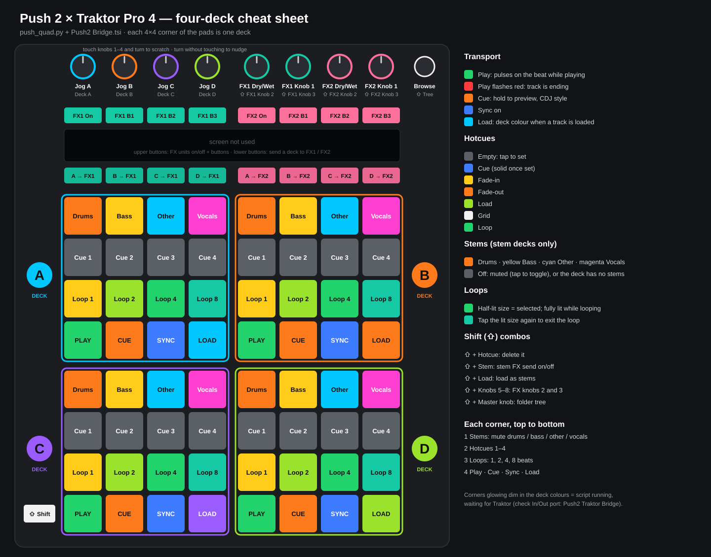

# Push 2 × Traktor Pro 4

Use an Ableton Push 2 as a four-deck Traktor controller on macOS, with coloured,
beat-synced pads. A small background script does the lights, because Traktor on
its own can only switch controller LEDs on and off.



## Install

You need macOS, Traktor Pro 4 (opened at least once), Python 3.9+ and a Push 2.

```bash
git clone https://github.com/Kimina-Santuri/push2-traktor.git
cd push2-traktor
./install.sh
```

The installer:
- puts the bridge in `~/Library/Application Support/Push2TraktorBridge`;
- starts it now and at every login;
- builds the Traktor mappings and copies them to your Desktop.

Then:

1. Quit Ableton Live and plug in the Push. There's no need to press User; the script switches it over.
   Each corner glows dim in its deck colour while it waits for Traktor.
2. Traktor → Preferences → Controller Manager → **Import TSI** → `Push2 Bridge.tsi`.
   In-Port and Out-Port must both say **Push2 Traktor Bridge**.
3. Set Traktor to 4 decks (Preferences → Decks → Deck Layout).

The corners switch to the full layout as soon as Traktor answers.

Options: `./install.sh --layout advanced` for the 8-column layout below, `--no-login-item`
to start it yourself. `./uninstall.sh` removes everything.

## Four-deck layout (default)

Each 4×4 corner of the pads is one deck, placed like Traktor's decks: A top-left, B top-right,
C bottom-left, D bottom-right.

| Row in each corner | Pads | Shift + pad |
|---|---|---|
| 1 Stems | Drums, Bass, Other, Vocals: tap to mute (dim red). Grey on non-stem decks. | Stem FX send |
| 2 Hotcues | Grey = empty, tap to set. Lit in the cue-type colour. | Delete |
| 3 Loops | 1, 2, 4, 8 beats. The current size pulses while looping; tap it again to exit. | |
| 4 Transport | Play (pulses green on the beat, flashes red at the end), Cue (CDJ style), Sync, Load | Load as stems |

- **Knobs 1–4:** jog for Decks A–D. Touch and turn to scratch; turn without touching to nudge.
- **Knobs 5–8:** FX1 dry/wet, FX1 knob 1, FX2 dry/wet, FX2 knob 1. **Shift:** knobs 2 and 3 of each unit.
- **Buttons above the screen:** FX1 on + buttons 1–3, FX2 on + buttons 1–3.
- **Buttons below the screen:** send Deck A–D to FX1 (left four) or FX2 (right four).
- **Master knob:** browse the track list. **Shift:** folder tree.

## Advanced layout (`--layout advanced`)

Eight columns for the focused deck, with modes:

| Control | Does |
|---|---|
| 4 buttons under the screen, left | Modes: **CUES / STEMS / REMIX / USER** |
| 4 buttons under the screen, right | Focus deck **A–D**; pulses on the beat, flashes red near the end of the track |
| 8 buttons above the screen | FX1 on + buttons 1–3, FX2 on + buttons 1–3 |
| Encoders 1–8 | CUES/USER: FX knobs · STEMS/REMIX: slot volume 1–4, slot filter 1–4 (Shift = fine) |
| Master encoder / Browse | Browse list (Shift = tree) / load to focused deck (Shift = as stems) |
| Play / Record / Touch strip | Play-pause / Cue / filter |

**CUES mode, top row first:**
- **Row 8:** hotcues 1–8, coloured by type.
- **Row 7:** prev/next/store/delete cue, CUP, Censor, Flux, Keylock.
- **Row 6:** beatjump ±16/4/1 and loop in/out.
- **Row 5:** loop sizes ¼–32.
- **Row 4:** loop on, sync, master, FX assign, filter, load.
- **Rows 3–2:** 16 free pads (Ch06 notes 0–15).
- **Row 1:** a 2-bar beat counter.

**Other modes:**
- **STEMS:** mute, FX send and a volume bar for each stem.
- **REMIX:** 16 cells per slot, which breathe while playing.
- **USER:** all 64 pads send Ch07 notes 36–99. Out mappings pick palette colours 1–36: red, orange, yellow, lime, green, teal, cyan, blue, purple, magenta, pink and white, each as full/mid/dim.

## No-script version: `Push2 Simple.tsi`

Two decks, plain on/off lights, nothing running in the background. Press **User** on the Push,
import `Push2 Simple.tsi` and set both ports to **Ableton Push 2 (User Port)**. Lights from
Traktor straight to the Push weren't confirmed in testing; use the bridge for reliable colours.

## Troubleshooting

- **Pads stay dark:** the script isn't running or the Push isn't connected. Check
  `~/Library/Logs/push2-traktor-bridge.log`.
- **Corners stay dim:** Traktor isn't talking to the script. Check that the In-Port and Out-Port are **Push2 Traktor Bridge**.
  For more detail, stop the login item and run it with `--monitor` to see what Traktor sends:
  `launchctl bootout gui/$(id -u)/local.push2-traktor-bridge`, then
  `~/Library/Application\ Support/Push2TraktorBridge/venv/bin/python ~/Library/Application\ Support/Push2TraktorBridge/push_quad.py --monitor`.
- **Ableton Live grabbed the Push:** quit Live; the script switches the Push back to User mode on reconnect.

## Development

See [AGENTS.md](AGENTS.md) for the file map, the MIDI contract, the reverse-engineered `.tsi`
format and how to run the hardware-free simulator test.

## License

MIT. See [LICENSE](LICENSE). Not affiliated with Ableton or Native Instruments.
